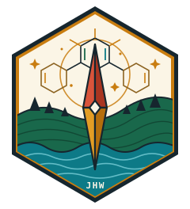
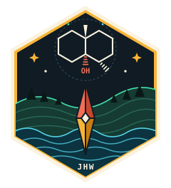

Hi, I'm James Wade.

I'm a research scientist and analytical chemist at a large chemicals R&D organization. I still spend time in the lab, and I also build developer tools for researchers across the R and Python ecosystems. I build internal packages, ship Shiny apps to production, and maintain open-source projects covering agentic AI workflows ([deputy](https://github.com/JamesHWade/deputy), [dsprrr](https://github.com/JamesHWade/dsprrr), [tempest](https://github.com/JamesHWade/tempest), [scans](https://github.com/JamesHWade/scans), [graft](https://github.com/JamesHWade/graft)), agent-native Shiny interfaces ([shinymcp](https://github.com/JamesHWade/shinymcp), [rill](https://github.com/JamesHWade/rill), [gptstudio](https://github.com/MichelNivard/gptstudio), [gpttools](https://github.com/JamesHWade/gpttools)), and tidy analytical characterization ([measure](https://github.com/JamesHWade/measure), [measure.sec](https://github.com/JamesHWade/measure.sec), [van-deemter-lab](https://github.com/JamesHWade/van-deemter-lab)).

Before all this, I was a bench chemist. I grew up in South Carolina and started my chemistry training at [Furman University](https://www.furman.edu/academics/chemistry/), a small liberal arts school in the upstate. That's where I found analytical chemistry: working on the abiotic origins of life, transition metal synthesis, and drug-DNA interactions for anticancer therapeutics.

I did my graduate work at the [University of Illinois at Urbana-Champaign](https://chemistry.illinois.edu), in [Ryan Bailey's lab](https://www.baileylab.com), building silicon photonic biosensors and microfluidic tools for cancer diagnostics and precision medicine.

I live in mid-Michigan with my wife and our three kids. My wife is a veterinarian who brings home too many furry friends: the current menagerie is one dog and four cats.

[View Resume](/resume/) · [Download PDF](resources/resume.pdf)

---

::: {.about-crest-block}
::: {.crest-art}
{.light-content width=148 alt="Mid-Michigan Hex-Compass crest (light)"}
{.dark-content width=148 alt="Mid-Michigan Hex-Compass crest (dark)"}
:::

::: {.crest-copy}
### About the Hex-Compass

The site's mark combines a chemistry benzene ring, an `#rstats` package hex, and a compass needle. The full crest puts `(-)-geosmin` (the molecule behind petrichor, wet forest soil, and fresh lake air) in the sky over mid-Michigan pine hills and Great Lakes waves.
:::
:::
