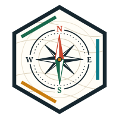
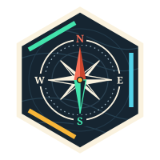
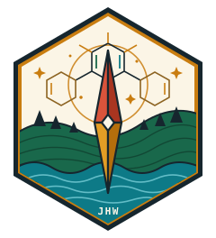
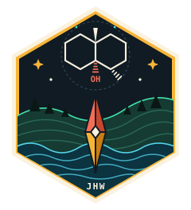
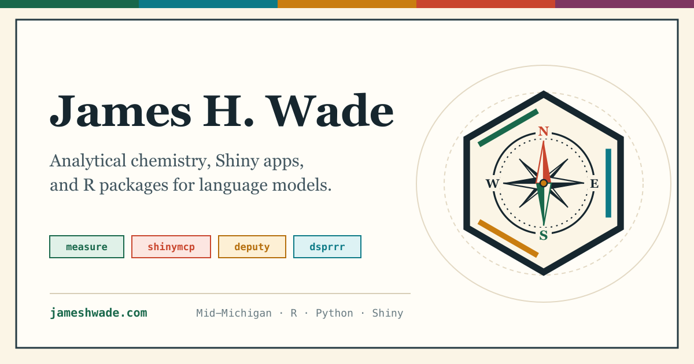

The **Hex-Compass** brings together a chemistry benzene ring, an `#rstats` package hex, and a compass needle. All three variants live in [`_brand.yml`](https://github.com/JamesHWade/jameshwadedotcom/blob/main/_brand.yml) with dedicated light and dark assets. Flip the theme toggle in the navbar to preview both modes.

## Logo Variants

::: {.brand-tier-grid}

::: {.brand-card}
::: {.brand-stage}
{.light-content width=96 alt="Open-corner geometric Hex-Compass (light)"}
{.dark-content width=96 alt="Open-corner geometric Hex-Compass (dark)"}
:::

### Small (`logo.small`)

Open-corner hexagon with three aromatic inner bond bars and a 4-point compass star. Used in the navbar and browser favicon.

::: {.brand-downloads}
[Light SVG](images/brand/hex-compass-small-light.svg) · [Dark SVG](images/brand/hex-compass-small-dark.svg) · [PNG](images/brand/hex-compass-small-light.png)
:::
:::

::: {.brand-card}
::: {.brand-stage}
{.light-content width=124 alt="Engraved Hex-Compass seal (light)"}
{.dark-content width=124 alt="Engraved Hex-Compass seal (dark)"}
:::

### Medium (`logo.medium`)

Solid hexagon framing subtle contour lines, a fine degree ring, and an 8-point compass rose. Used in RevealJS slides, Typst PDFs, and social cards.

::: {.brand-downloads}
[Light SVG](images/brand/hex-compass-medium-light.svg) · [Dark SVG](images/brand/hex-compass-medium-dark.svg) · [PNG](images/brand/hex-compass-medium-light.png)
:::
:::

::: {.brand-card}
::: {.brand-stage}
{.light-content width=124 alt="Illustrated Mid-Michigan Hex-Compass crest (light)"}
{.dark-content width=124 alt="Illustrated Mid-Michigan Hex-Compass crest (dark)"}
:::

### Large (`logo.large`)

Hex crest combining benzene rings, pine hills, Great Lakes waves, a faceted compass needle, and `JHW` at the bottom vertex.

::: {.brand-downloads}
[Light SVG](images/brand/hex-compass-crest-light.svg) · [Dark SVG](images/brand/hex-compass-crest-dark.svg) · [PNG](images/brand/hex-compass-crest-light.png)
:::
:::

:::

## Wordmark Lockup & Favicons

::: {.brand-lockup-showcase}
{.light-content width=380 alt="James H Wade horizontal lockup (light)"}
{.dark-content width=380 alt="James H Wade horizontal lockup (dark)"}

::: {.brand-downloads}
[Light Lockup SVG](images/brand/hex-compass-lockup-light.svg) · [Dark Lockup SVG](images/brand/hex-compass-lockup-dark.svg) · [Adaptive Favicon SVG](images/favicon.svg) · [favicon.ico](images/favicon.ico)
:::
:::

## Color Palettes

Inspired by vintage Great Lakes field guides and National Park posters in light mode, and a midnight lake sky in dark mode.

::: {.brand-palette-grid}

::: {.palette-panel .palette-light}
### Light Palette

```{=html}
<div class="swatch-row">
  <div class="swatch"><span style="background:#FBF5E6; border:1px solid #C8BDA2;"></span><code>#FBF5E6</code><small>Vellum</small></div>
  <div class="swatch"><span style="background:#16262E;"></span><code>#16262E</code><small>Ink Slate</small></div>
  <div class="swatch"><span style="background:#19684B;"></span><code>#19684B</code><small>Pine</small></div>
  <div class="swatch"><span style="background:#0D7A87;"></span><code>#0D7A87</code><small>Lake</small></div>
  <div class="swatch"><span style="background:#C97D10;"></span><code>#C97D10</code><small>Ochre</small></div>
  <div class="swatch"><span style="background:#C9462E;"></span><code>#C9462E</code><small>Copper</small></div>
  <div class="swatch"><span style="background:#7E3661;"></span><code>#7E3661</code><small>Plum</small></div>
</div>
```
:::

::: {.palette-panel .palette-dark}
### Dark Palette

```{=html}
<div class="swatch-row">
  <div class="swatch"><span style="background:#101B24; border:1px solid #35586C;"></span><code>#101B24</code><small>Midnight</small></div>
  <div class="swatch"><span style="background:#FAF2DF;"></span><code>#FAF2DF</code><small>Starlight</small></div>
  <div class="swatch"><span style="background:#42E3AC;"></span><code>#42E3AC</code><small>Aurora</small></div>
  <div class="swatch"><span style="background:#54D2E8;"></span><code>#54D2E8</code><small>Bay</small></div>
  <div class="swatch"><span style="background:#F7B538;"></span><code>#F7B538</code><small>Amber</small></div>
  <div class="swatch"><span style="background:#F46E57;"></span><code>#F46E57</code><small>Coral</small></div>
  <div class="swatch"><span style="background:#DE85D4;"></span><code>#DE85D4</code><small>Orchid</small></div>
</div>
```
:::

:::

## Typography & Social Card

::: {.brand-bottom-grid}

::: {.brand-card}
### Typography

- **Headings & body:** Newsreader
- **Navigation & UI labels:** Bricolage Grotesque
- **Code & tags:** JetBrains Mono
:::

::: {.brand-card}
### Social Preview Card (`1200×630`)

{alt="James H Wade Open Graph social preview card" style="border: 1.5px solid var(--s-border-ink); width: 100%;"}

::: {.brand-downloads}
[PNG (1200×630)](images/og-card.png) · [SVG Source](images/brand/og-card-source.svg)
:::
:::

:::

## Reusing `_brand.yml`

```bash
# Pull this brand into a Quarto slide deck or report
quarto use brand JamesHWade/jameshwadedotcom
```

```r
# Reuse in a Shiny / bslib app
bslib::bs_theme(brand = "_brand.yml")
```
